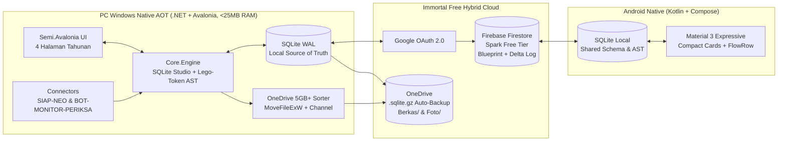

# Landasan Teori, Analisis Data Kerja Nyata (`Data IP 2026`), Dokumen Pabean (PIB/LHP/BL), & Meta-Arsitektur MinePerform

Dokumen ini merupakan cetak biru analitis yang **100% terkalibrasi dengan alur kerja nyata pemeriksaan fisik (`Data IP 2026.xlsx` — 9 Sheet: `INPUT`, `Jam Presensi`, `Calc Pack`, `Data Master`, `Cek IKU`, `REVIEW`, `PIVOT`, `Catatan`, `DASHBOARD`)** serta sampel berkas **PIB BC 2.0, Lembar Lanjutan, LHP, dan B/L**.

---

## BAGIAN I: ANATOMI DATA KERJA NYATA (`INPUT` — 56 KOLOM DALAM 4 GRUP)

Dari data nyata pemeriksaan fisik tahun 2026, teridentifikasi **4 Super-Header (Grup Kolom)** dan **5 temuan rekayasa data krusial** yang wajib ditangani otomatis oleh aplikasi:

### 1. Struktur 4 Grup Kolom (`Column Banding`)
1. **`INFO DASAR` (`#3B82F6` — 30 Kolom):**
   `No.` *(Frozen)*, `Status` (`SPPB`, *Frozen*), `No. IP` (format 6 digit seperti `814253` / `000765` maupun kode khusus seperti `ATA-003/IMPOR/2026`, *Frozen*), `Tanggal IP`, `TPS` (`MAL0`, `NCT1`, `JICT`, `TER3`, `GSRA`, `KOJA`, `1MUT`, `RAYA`, `TPP`, dst.), `Jenis Impor` (`Impor untuk Dipakai`, `Re-Impor`, `Impor Sementara`, `ATA Carnet`, `Impor untuk di Re-Ekspor`), `Importir`, `Pemilik Barang`, `PPJK`, `FCL/LCL`, `JML CONT 40F?`, `JML CONT 20F`, `CONT 40F? PERIKSA`, `CONT 20F PERIKSA`, `JML PK`, `JML PK PERIKSA`, `JUMLAH JENIS`, `JML JENIS PERIKSA`, `JENIS BARANG`, `CAMPURAN?`, `HS CODE 1 JENIS`, `NILAI PABEAN`, `BM`, `BMT`, `BM KITE`, `CUKAI`, `PPN`, `PPnBM`, `PPh`, `TOTAL PDRI`.
2. **`DATA PEMERIKSAAN` (`#F59E0B` — 14 Kolom):**
   `TK PERIKSA` (`10%`, `30%`, `MENDALAM`), `Waktu PKB`, `Waktu Mulai Periksa`, `Selesai Periksa`, `Selesai LHP`, `Alasan Mulai >1 JAM`, `Kendala Pemeriksaan`, `Konfirmasi?`, `BARCON`, `Kesimpulan LHP`, `KET LAIN`, `TEMUAN?` (`TRUE`/`FALSE`), `Pengurus`, `No. HP`.
3. **`PUTUSAN PFPD` (`#8B5CF6` — 11 Kolom):**
   `SPBL`, `NOTUL?`, `BM-`, `DENDA ADM-`, `BMT-`, `BM KITE-`, `CUKAI-`, `PPN-`, `PPnBM-`, `PPh-`, `Total Kurang Bayar`.
4. **`LINK DATA` (`#10B981` — 1 Kolom Otomatis):**
   **`Nama Folder Onedrive`** dengan pola baku:
   `{No.}. {No. IP}_{Tanggal IP (dd.MM.yyyy)}_{Importir}_{TPS}_{JENIS BARANG}`
   *(Contoh: `1. 814253_26.12.2025_BERDIKARI_MAL0_FROZEN BONELESS BEEF`)*.

### 2. Lima Solusi Cerdas dari Temuan Anomali Data Nyata
1. **Sanitizer Format Mata Uang Excel (`" $2,880,771,505.92 "` & `" $- "`):**
   Pada ekspor CSV/Excel, nilai Rupiah kerap terekspor dengan simbol `$` akibat *locale* Windows. Mesin *Smart Importer* membersihkan simbol `$`, spasi, dan `-` menjadi angka `decimal` murni (`0` untuk `$-`), lalu menampilkannya rapi dalam format `Rp` (atau mata uang yang dipilih pengguna per kolom).
2. **Sanitizer Nama Folder Windows (*Path Safety Guard*):**
   Baris tertentu memiliki karakter ilegal Windows pada `No. IP` atau `JENIS BARANG` (seperti `/` pada `ATA-003/IMPOR/2026` di baris 57, atau baris baru `\n` di baris 179). Generator `Nama Folder Onedrive` otomatis mengganti `/` dengan `-` dan menghapus `\n` serta karakter NTFS terlarang (`: * ? " < > |`) agar pembuatan folder OneDrive tidak pernah gagal.
3. **Pencocokan Cerdas Foto 5 GB+ via `No. IP` ke `Nama Folder Onedrive`:**
   Saat folder sumber berisi 5 GB+ foto dinamai nomor dokumen (misal `001081` atau `814253`), mesin *Batch Sorter* mencocokkan nomor dokumen tersebut dengan kolom `No. IP` di tabel `INPUT`, mengambil nilai `Nama Folder Onedrive` yang telah disanitasi, membuat subfolder `Berkas/` dan `Foto/`, lalu memindahkan seluruh foto via *Zero-Copy* Win32 `MoveFileExW` + *bounded multi-threaded* `Channel<T>` ke `OneDrive/[Tahun]/[Nama Folder Onedrive]/Foto/` dan berkas PDF ke `.../Berkas/`.
4. **Deteksi Anomali Data Otomatis (*Data Hygiene Radar*):**
   Aplikasi otomatis menandai anomali seperti typo tahun pada tanggal (`05/11/2515` di baris 177) atau `JML JENIS PERIKSA` yang kosong (baris 111 & 180) dengan ikon `⚠️` tanpa menghentikan proses impor.
5. **Kolom Rumus Otomatis (*Computed Columns*):**
   Kolom turunan seperti `TOTAL PDRI`, `Total Kurang Bayar`, `JML PK PERIKSA` (berdasarkan `TK PERIKSA` `10%`/`30%`/`MENDALAM`), dan `Nama Folder Onedrive` didefinisikan sebagai kolom dinamis berbasis metadata di *No-Code SQLite Studio* sehingga terisi otomatis tanpa mengetik ulang.

---

## BAGIAN II: SISTEM MULTI-TAHUN, KODE IKU (`1a-N`, `1b-N`, `2a-N`), & SALIN KERANGKA LINTAS TAHUN

- **Kodefikasi IKU Kemenkeu:** `1a-N`, `1b-N`, `2a-N`, dst. (`-N` = *Non-Cascading*, `-CP` = *Cascading Peta*, `-CNP` = *Cascading Non-Peta*). Jumlah IKU per tahun bebas (3, 5, atau tak terbatas).
- **4 Halaman Terpadu per Tahun:**
  1. **`DATA`:** Menampung 1–5+ tabel bebas per tahun (`INPUT`, `Jam Presensi`, `Calc Pack`, `Data Master`, `Catatan`) dengan antarmuka ramah awam tanpa menulis SQL, dilengkapi **Visual Table Linker** dan **Laci Rincian Master-Detail** untuk *Lembar Lanjutan* PIB.
  2. **`IKU & FORMULA`:** Kanvas **100% Modular Lego-Token** lepas-pasang (*Drag & Drop* 120 FPS + *Click & Pin at Caret*), tanpa rumus *hardcode*.
  3. **`CHART & SUMMARY`:** Analitik *Bento-Grid* lintas periode (**Tahunan, Semester, Triwulan, Bulanan, Custom**), memantau capaian IKU, tren `NOTUL?`, `Total Kurang Bayar`, `TEMUAN?`, sebaran `TPS`, `Alasan Mulai >1 JAM`, dan proyeksi premi (*Run-Rate*).
  4. **`KONEKTOR & ONEDRIVE`:** Jembatan ke **`SIAP-NEO` / `SIAP-DESKTOP`** dan **`BOT-MONITOR-PERIKSA`**, serta pemindah foto **5 GB+** ke OneDrive.
- **Salin Kerangka Tahun (*Selective Blueprint Cloner*):** Menyalin struktur tabel, grup kolom, relasi, daftar IKU, rakitan *Lego-Token*, konfigurasi konektor, dan pola OneDrive dari tahun sebelumnya (`2026 -> 2027`) secara selektif via *checkbox* tanpa menyalin baris data lama.

---

## BAGIAN III: ARSITEKTUR CLOUD ABADI (GOOGLE AUTH + FIREBASE + ONEDRIVE) & KONEKTOR GANDA

- **Mengapa Tidak Supabase Free Tier?** Supabase gratis menidurkan proyek (*pause*) jika tidak ada kueri selama 7 hari. Solusi abadi 100% gratis adalah **Login Google (OAuth 2.0)** + **Firebase Firestore (Spark Free Tier — Tidak Pernah Tidur)** untuk menyinkronkan *Schema Blueprint* + *Compressed Delta Log* secara *real-time* antara PC Windows dan Android, ditambah cadangan otomatis berkas `.sqlite` utuh ke **OneDrive**.
- **Konektor Ganda:**
  - **`SIAP-NEO` / `SIAP-DESKTOP`:** Mengambil *timestamp* `Waktu PKB`, `Waktu Mulai Periksa`, `Selesai Periksa`, `Selesai LHP`, status `BARCON`, dan data pengurus/no. HP.
  - **`BOT-MONITOR-PERIKSA`:** Mengunduh berkas PIB, LHP, B/L, memicu kompilasi dokumen otomatis, serta mengelompokkan berkas ke `OneDrive/.../[Nama Folder Onedrive]/Berkas/` dan `.../Foto/`.
